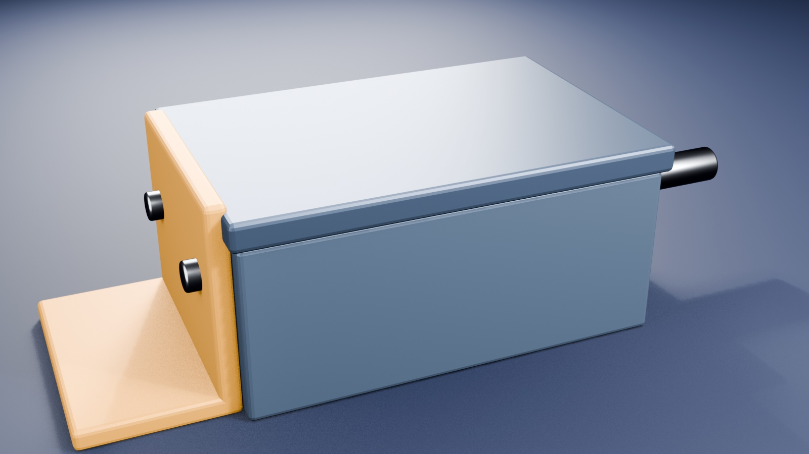
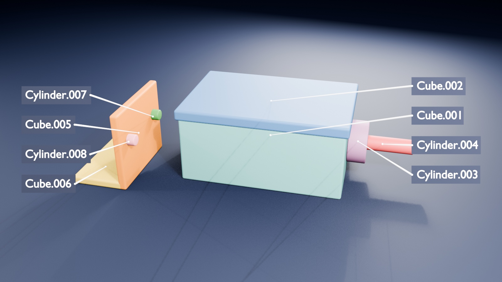

# Edition #44 fixture: a two-part assembly

The model used in [Selecting 3D Parts Reliably on visionOS](https://swiftinpractice.com/editions/44-visionos-realitykit-part-selection/).

| File | What it is |
| --- | --- |
| `assembly.usdz` | The assembly, ready for `Entity(contentsOf:)` on visionOS, iOS or macOS. |
| `manifest.json` | Maps each stable part-root path to a domain part. |
| `assembly.blend` | The Blender scene the USDZ was exported from. |
| `make_assembly.py` | Builds the scene, exports the USDZ and renders both images. |





## The hierarchy RealityKit loads

```
<root>
└─ Assembly
   ├─ Housing          ← part root, listed in manifest.json
   │  ├─ Cube_001 … Cylinder_004   (leaf meshes, names chosen by the export tool)
   └─ Bracket          ← part root, listed in manifest.json
      └─ Cube_005 … Cylinder_008
```

Only the part-root paths are a contract. Everything below them may be split, merged or renamed by the next export.

## Rebuild it

```sh
blender -b --factory-startup --python make_assembly.py -- out
```

Try the edition's test: rename the leaf meshes in `make_assembly.py`, rebuild, and load the new USDZ with the same manifest. Every tap should still resolve to the same part.
